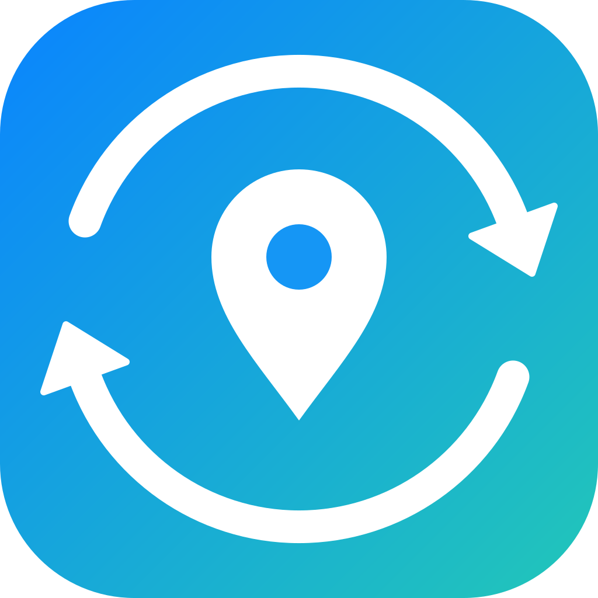

  

<h1 align="center">Navigation Switcher</h1>

Safari Web Extension that opens maps links in the app you prefer: Google Maps links go to Apple Maps, or the reverse, depending on your setting.

- `extension/convert.js` – Google ⇄ Apple Maps URL conversion (places, coordinates, search, directions)
- `extension/popup.*` – settings panel: default maps app and the conversion counter
- `extension/content.js` – redirects links that point at the non-default app at `document_start`
- `extension/background.js` – resolves `maps.app.goo.gl` short links

## Test

    node --test test/

## Build for iOS (requires full Xcode)

    xcrun safari-web-extension-converter extension --ios --app-name "Navigation Switcher" --project-location ios

Open the generated project, set your signing team, run on your iPhone, then
enable it in Settings → Apps → Safari → Extensions and allow the listed websites.

## License

[MIT](LICENSE)
